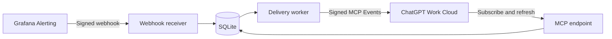

# chatgpt-grafana-alerts

Receive Grafana alert notifications in ChatGPT through an MCP Events server you
host and operate yourself.

The initial implementation includes signed webhook intake, SQLite persistence,
firing/resolved events, filtered subscriptions, verified callbacks, signed
delivery, bounded retries, and replay. It includes a plugin skill and a packaging
command. Live ChatGPT subscription delivery requires a separate acceptance test.



One repository contains the independently deployable server and the plugin
package. No OpenAI API key or Grafana API token is required by this server.
Grafana sends notifications to it, and ChatGPT supplies callback destinations
when subscribing.

## Local development

Use Node.js 26 and npm:

```sh
npm ci
cp .env.example .env
node -e "console.log(require('node:crypto').randomBytes(32).toString('base64'))"
```

Generate three separate values for `GRAFANA_WEBHOOK_SECRET`, `STORAGE_KEY`, and
`DEV_MCP_TOKEN` and place them in `.env`. Keep the OAuth fields empty for local
development. Then run:

```sh
npm run check
npm start
```

Development mode listens on `127.0.0.1:3000` and accepts the development bearer
token at `/mcp`. It cannot run with a production environment or a non-loopback
bind address. It is for local clients and tests, not a ChatGPT cloud connection.
Callback destinations still require publicly routable HTTPS in development.

## Production configuration

See [deployment](deploy/README.md) for Cloudflare Access or external OAuth,
the HTTPS proxy, storage volumes, and environment requirements. The server supports **one
configured Grafana source**. Every allowlisted OAuth subject can read that
source's retained alert history; subscriptions and their status are owner-scoped.

Create a Grafana **Webhook** contact point only after deploying the receiver:

| Grafana setting | Value |
| --- | --- |
| URL | Your origin followed by `/webhooks/grafana/<SOURCE_ID>` |
| HTTP method | `POST` |
| HMAC secret | The server's `GRAFANA_WEBHOOK_SECRET` |
| HMAC signature header | `X-Grafana-Alerting-Signature` |
| Timestamp header | `X-Grafana-Alerting-Timestamp` |
| Max Alerts | `0` to avoid truncation |
| Disable resolved message | Off when recovery notifications are wanted |

The server requires the signed timestamp and rejects notifications more than
five minutes away from its clock. Configure a synchronized clock on both sides.
It acknowledges a notification only after all included alerts have been stored
in one transaction. Requests are limited to 2 MiB and 500 alerts, and individual
normalized events must fit within 240 KiB before cursor metadata is attached.
Exact repeated normalized alert snapshots are deduplicated;
this deliberately suppresses unchanged Grafana reminder notifications. State,
timestamp, label, or annotation changes produce distinct events.

## ChatGPT plugin

After deployment, verify the actual MCP endpoint and OAuth flow, then generate
the package:

```sh
MCP_URL=https://your-actual-host/mcp npm run package:plugin
```

This writes an installable source directory and a tar.gz under `dist/`, including
the endpoint-specific `mcp.json`. The packaging command does not deploy the
server, verify the endpoint, install a plugin, or publish a directory listing.
Do not use the illustrative hostname above as a real connection.

Connect the server through ChatGPT's custom MCP server flow and install the
plugin. Verify that events are discovered. In a supported Work cloud chat, ask:

> Subscribe to critical firing and resolved alerts from the advertised source.
> Summarize each matching alert and notify me when it resolves.

The advertised source must match `SOURCE_ID`; critical filtering matches the
literal label `severity=critical`. There are separate subscriptions for firing
and resolved notifications. Available tools are `list_alerts`, `get_alert`, and
`subscription_status`. They read local notification history and delivery state;
they do not query Grafana metrics, silence alerts, or change infrastructure.

## Recovery and limits

- Subscriptions and callback signing secrets survive server restarts. Preserve
  the database and the same `STORAGE_KEY`; callback secrets are AES-GCM encrypted.
- New subscriptions start at the current event position. Refreshes preserve the
  older of server progress and the client's valid replay cursor. Retried events
  keep the same event ID. Delivery is at least once while retries succeed;
  duplicates and source events arriving out of order are possible.
- Transient failures receive up to eight attempts. Permanent errors stop the
  subscription's delivery; `410` marks it gone. Failed events remain stored and
  visible. An explicitly renewed, verified subscription can resume its backlog.
- Subscription grants last up to one hour, bounded by the requested lifetime
  and the authenticating token's expiration. Even a no-expiry request receives
  a finite grant. Expired subscriptions stop delivering until renewed.
- Events are retained without automatic pruning. The backup service takes a
  consistent SQLite snapshot every six hours and retains seven local snapshots.
  Preserve the matching encryption key separately; offsite backup is not configured.
- The server cannot replay alerts it never received from Grafana. It cannot
  guarantee when ChatGPT will resubscribe after a prolonged outage.
- A successful callback means ChatGPT accepted the event, not that a task ran
  successfully. Grafana timing and ChatGPT processing can introduce delays.
- The worker supports one application process and one local SQLite database.
  Multiple replicas sharing that database are not supported.

## Validation

`npm run check` runs strict TypeScript checking and the complete local test suite.
Tests exercise HTTP intake, OAuth and Cloudflare assertion authentication,
filtering, replay, retries, refresh races, expiry, backup restoration, restart
durability, and callback address rejection. `npm run test:container` validates the
production image in an isolated Compose project, including signed intake,
forged-assertion rejection, restart persistence, and backup from a read-only mount.
Callback responses in service tests are simulated; live DNS/TLS delivery,
provider setup, and ChatGPT behavior require deployment validation.

Version tags trigger a GitHub Actions pipeline that validates, builds, and
publishes the image to GHCR. It does not install or update anything on the VPS.
Installation and updates are manual operations inside the VPS.

See [protocol details](docs/protocol.md) and [deployment acceptance](docs/acceptance.md).

## References

- [ChatGPT MCP Events](https://developers.openai.com/plugins/build/mcp-events)
- [MCP Streamable HTTP](https://modelcontextprotocol.io/specification/2026-07-28/basic/transports/streamable-http)
- [Plugin authentication](https://developers.openai.com/plugins/build/auth)
- [Plugin packaging](https://developers.openai.com/plugins/build/plugins)
- [Grafana webhooks](https://grafana.com/docs/grafana/latest/alerting/configure-notifications/manage-contact-points/integrations/webhook-notifier/)
